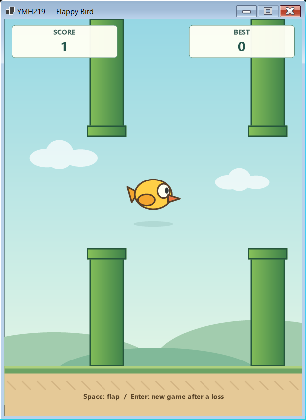

# YMH219 — Flappy Bird

A C# Windows Forms desktop game project for **Nesne Tabanlı Programlama (YMH219)**. The project demonstrates object-oriented design, event-driven programming, testing, and a reviewed Git workflow.

**Gameplay implementation is complete. Final submission review is in progress.** Fly through moving pipes, earn points, lose on pipe/ground contact, and start a new run with Enter or the New game button. Separate Score/Best displays, focus pause, and saved best scores are included. PRs #1–#8 are merged. Automated checks, clean-checkout verification, and application screenshots are complete; the owner's full name and manual sign-off remain outstanding in the [submission checklist](docs/SUBMISSION.md).

## Quick start

Requirements: Windows 10/11, the .NET **10.0.402 SDK** (or a newer patch in the 10.0.4xx feature band), Git, and optionally VS Code with the recommended C# extensions. A runtime alone cannot build the project. NuGet access is required for the first restore. No Unity, database, API key, or additional .NET workload is required.

From the repository root in PowerShell:

```powershell
./scripts/dev.ps1 doctor
./scripts/dev.ps1 check
./scripts/dev.ps1 run
```

The launcher resolves `dotnet` from `PATH`, uses that installation as `DOTNET_ROOT`, and keeps CLI state in the ignored `.local/dotnet` folder. It restores inherited environment values when it exits. See [setup and troubleshooting](docs/SETUP.md).

Open the root folder in VS Code, install the recommended extensions, and use **Ctrl+Shift+B** to build or **F5** to debug. The application uses programmatically constructed controls rather than Designer files.

## Project layout

```text
src/
  FlappyBird.App/           Window, rendering, input/timing, high-score services
  FlappyBird.Core/          Models, swept collision, GameEngine/PipeSystem, gap generation
tests/
  FlappyBird.Core.Tests/    xUnit behavior tests
  FlappyBird.App.Tests/     Renderer, input/timing, invisible Form/restart tests
scripts/dev.ps1            Local setup diagnostics and development commands
docs/                      Architecture, decisions, workflow, QA, and requirements
.github/                   Windows CI and pull request template
.vscode/                   Shared build, test, and debug configuration
FlappyBird.slnx             Solution containing App, Core, and Tests
global.json                SDK selection
```

App and Core.Tests reference Core; App.Tests references App for rendering/input/timing checks. Core must not reference App or Windows Forms. Additional folders will be added when they contain implemented features.

## Roadmap

| Stage | Deliverable | Branch | Status |
| --- | --- | --- | --- |
| 00 | Solution, shell, tests, CI, and documentation | `chore/initialize-project` | Merged in PR #1 |
| 01 | Window rendering, background, ground, bird | `feat/game-window` | Merged in PR #2 |
| 02 | Gravity, flap, KeyDown/KeyUp input | `feat/bird-physics` | Merged in PR #3 |
| 03 | Moving and recycled pipe obstacles | `feat/pipe-system` | Merged in PR #4 |
| 04 | Collision, score, Game Over, restart | `feat/game-rules` | Merged in PR #5 |
| 05 | UI polish and persistent high score | `feat/game-polish` | Merged in [PR #6](https://github.com/alaamadii/FlappyBird/pull/6) |
| 06 | Final QA, screenshots, submission review | `docs/final-submission` | Evidence merged in [PR #7](https://github.com/alaamadii/FlappyBird/pull/7); name/manual sign-off pending |

Every stage uses a separate branch and pull request. Review the diff, test results, and documentation before merging. The owner decides when to merge. The overall brief targets five separate assignments by **November 30, 2026, 23:59 Asia/Riyadh**; this repository covers Flappy Bird only.

## Documentation

- [Completion plan](docs/PLAN.md): stage-by-stage tasks, acceptance criteria, target dates, and review gates for finishing Flappy Bird.
- [Setup and troubleshooting](docs/SETUP.md): tools, environment, VS Code, common failures.
- [Architecture](docs/ARCHITECTURE.md): current responsibilities and intended game design.
- [Decisions](docs/DECISIONS.md): choices, rationale, and tradeoffs.
- [Development workflow and log](docs/DEVELOPMENT.md): stages, branching, review, actual changes.
- [Testing](docs/TESTING.md): commands, assertions, UI checks, and evidence.
- [High-score storage](docs/HIGH_SCORE.md): location, format, failure handling, and isolated tests.
- [Requirements](docs/REQUIREMENTS.md): acceptance criteria and implementation status.
- [Submission checklist](docs/SUBMISSION.md): final verification and oral explanation preparation.
- [Code walkthrough](docs/CODE_GUIDE.md): class responsibilities, event paths, rules, and examples to explain.
- [Agent working agreement](AGENTS.md): rules for automated project work.

## Validation and limitations

Use `./scripts/dev.ps1 check` to restore, build Release, run tests, and verify formatting. The Windows GitHub Actions workflow runs the same command on pull requests and pushes to `main`, then uploads TRX results. Workflow configuration does not imply that a hosted CI run has passed; execution evidence is recorded in [TESTING.md](docs/TESTING.md).

Mandatory gameplay and optional high-score persistence are implemented and regression-tested: **162 tests (97 Core, 65 App)**. A fresh GitHub clone restored, built, passed the full check, and launched/closed normally on the development computer. After the owner reported fast falling and oversized Space hops, flight now uses a smaller hop, lighter gravity and capped descent. Acceptance of the revised feel, other physical display/input checks, and another-computer sign-off remain pending. Audio, progressive speed, and selectable difficulties are deferred. Scripted checks do not establish human difficulty or fairness. The bird uses a conservative rectangular hitbox rather than pixel-perfect artwork collision. No distribution package or third-party assets are included. A license has not yet been selected.

## Technologies and NuGet packages

C#/.NET 10, Windows Forms, original GDI+ drawing, a WinForms timer with Stopwatch timing, and an independent .NET domain library. Both test projects reference `Microsoft.NET.Test.Sdk` 17.14.1, `xunit` 2.9.3, and `xunit.runner.visualstudio` 3.1.4; Core.Tests also references `coverlet.collector` 6.0.4. App and Core have no third-party package dependencies.

## Controls and flight

| Action | Behavior |
| --- | --- |
| Space while Ready | Starts Running and flaps upward |
| Release, then press Space while Running | Flaps once; holding Space does not repeat |
| Space during Game Over | Ignored; does not click a focused New game button |
| Enter or click New game during Game Over | Resets to Ready with score zero; release Space, then press to start |
| Switch away or minimize | Freezes the run, shows Paused while Running, and clears timing accumulation |
| Return | Resumes a live run without catch-up; Game Over remains stopped |

Gravity is 360 logical units/s², flap velocity is −160 units/s, and downward speed is capped at 240 units/s. A single flap rises about 34 units and returns to its starting height in about 0.88 seconds. This reduces the previous candidate's roughly 54-unit hop without shortening its floaty cadence, and prevents long falls from accelerating indefinitely. Motion uses fixed 1/60-second updates; each timer tick accepts at most 100 ms and performs at most six updates. Excess stall time is discarded. At the ceiling, Y is clamped and upward velocity cleared. See [architecture](docs/ARCHITECTURE.md) for the formula and policies.

## Collision, score, and restart

The bird's logical 86 × 48 rectangle touches either pipe rectangle or the ground to trigger Game Over; exact edge/corner contact counts. The decorative shadow is excluded. Ceiling contact clamps movement without ending the run. Swept contact checks prevent fast movement from skipping thin obstacles.

Each pair earns one point when its trailing edge is strictly left of the bird's left edge, during a collision-free simulation step. Contact is evaluated before a new point; a loss keeps earlier points and freezes motion, recycling, and scoring. Pair eligibility resets on recycling.

Game Over shows final score, best score, and a New game button with a visible keyboard focus border. Button or Enter resets score, bird, pipes/gaps, eligibility, state, input and timing to a clean Ready state. A held Space must be released before it can start the new run. Best score survives reset; restart is never automatic.

## Saved best score

Best is loaded once at startup and updated when a completed run improves it. Current Score starts at zero each run. A successful save happens once on entering Game Over for a new best, never during painting or ordinary timer ticks.

The file is `%LOCALAPPDATA%\YMH219-FlappyBird\high-score.txt`: a UTF-8 decimal integer from 0 to 2,147,483,647. Missing data means a normal first launch. Invalid/unreadable data shows “Saved best score unavailable.”; a failed save shows “Best score couldn't be saved.” without a dialog. Your new best remains available for the current session and is retried when the next run finishes. A successful save clears the warning.

Writes use a completed temporary file in the same folder before replacing the score file. A failed replacement preserves the previous valid score. Data is personal to this Windows user, with no cloud sync or coordination between simultaneously running instances. Tests use temporary directories or injected memory stores. See [storage details](docs/HIGH_SCORE.md).

## Pipe behavior

Two pairs (four pipe shapes) remain still while Ready and move left at 140 logical units/s while Running. Their initial left edges are X=520 and X=780, giving about 1.69 seconds before the first pair reaches the bird's initial right edge. Both pairs can be fully visible together.

Each pair is 64 units wide with a 180-unit vertical opening. Spacing is **260 units between left edges**, leaving 196 units of empty horizontal space. Gap tops are sampled in **[40, 340)**: minimum included, maximum excluded. Upper/lower rectangles end at the gap edges and shared ground boundary. Generation uses an instance-owned random source that tests can replace.

A pair recycles only when its right edge is strictly below X=0. It moves after the other pair at the same spacing and receives a fresh gap sample; the same two objects are reused. The engine checks collision and score before recycling, preserving the departing pair's pass. Focus pause freezes the whole engine.

Settings are finite/positive and validated against Playfield. Engine updates accept [0, 1] seconds in every state and split Running updates into at most 60 rule steps of no more than 1/60 second. Swept contact is checked before movement/recycling. The UI retains its existing fixed-step loop and catch-up cap.

## Scene behavior

The renderer uses the 480 × 640 logical playfield with ground beginning at Y=560. Shapes, strokes, and pixel-unit fonts scale together to the actual client area. Uniform scaling and centered borders preserve proportions when the client aspect ratio differs. WinForms DPI autoscaling uses a 96-DPI baseline; the window remains fixed-size with maximize disabled.

The renderer reads Bird, state, current/best scores, pause/status presentation, and pipe geometry. It paints pipes before the bird, separate corner score cards while Running, an inactive pause card, and a dimmed final-score card on Game Over. Instructions sit in the ground region. A shared SceneViewport mapping keeps the native restart button and its pixel-unit font aligned with painted content at different client sizes. Painting never changes domain state, randomness, or storage. Accessible descriptions cover Ready, Running, paused, Game Over, best, restart, and storage warnings.

## Screenshots and student details

Actual application-window captures taken on November 17, 2026 at 125% desktop scaling. An isolated scripted run uses controlled gaps and normal scoring/contact logic. These images are not evidence of human playtesting; [capture details](docs/screenshots/README.md) record their source and limitations.



*Running: score 1 after a valid pass. Best stays 0 until this run finishes.*


*Game Over after ground contact: final score 1, saved best 1, and keyboard-accessible restart.*

| Student detail | Status |
| --- | --- |
| Full name | Awaiting owner-provided value |

The owner's full name remains pending. See the [remaining sign-off items](docs/SUBMISSION.md).

## Repository and submission

The owner's selected repository is [alaamadii/FlappyBird](https://github.com/alaamadii/FlappyBird). The instructor recommends the name `YMH219-FlappyBird`; the selected name is retained. The PDF was checked on November 16, 2026 and requires public access, meaningful commits, at least two screenshots, student details, and a second-computer check. The owner authorized public visibility on November 17, 2026; anonymous repository access and its public profile listing were verified that day.

The owner submits their GitHub profile link in Classroom. The full [completion plan](docs/PLAN.md) tracks the remaining work and acceptance gates.
