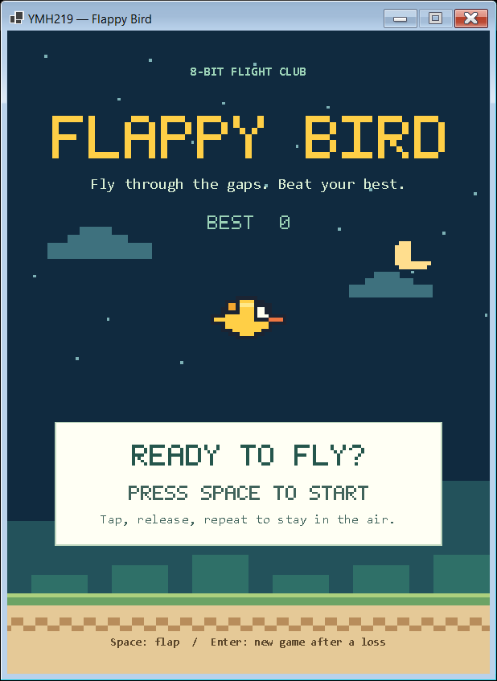
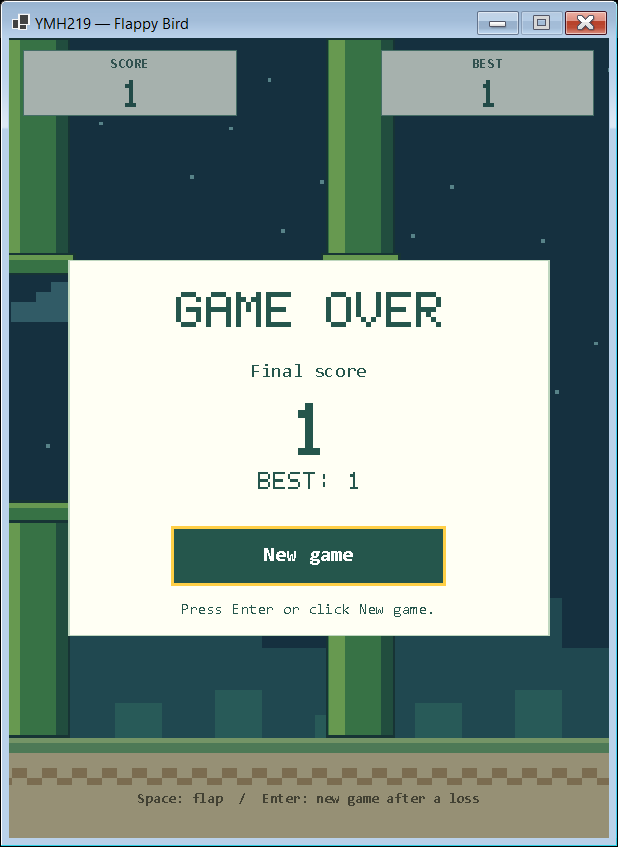

# YMH219 :Flappy Bird

A retro arcade game built with **C#/.NET 10 and Windows Forms** for **Nesne Tabanlı Programlama (YMH219)**. Guide a pixel-art bird through moving pipes, improve your score, and try again after each collision.

The project demonstrates object-oriented design through an independent game engine, Windows presentation and input, automated tests, and development reviewed through pull requests. Gameplay is implemented; final submission sign-off and review of the retro presentation remain in progress.

## Features

- Original pixel-art scenery, animated wings, visual bird tilt, and scrolling terrain.
- Keyboard-controlled flight with a smaller hop, gentle gravity, and capped falling speed.
- Recycled pipe obstacles, collision detection, and one point for each completed pass.
- Ready, Running, and Game Over states with keyboard-accessible restart.
- Automatic pause when the window loses focus or is minimized.
- A best score saved locally between sessions, with nonmodal feedback if storage is unavailable.
- A fixed-size window with proportional rendering and DPI-aware native controls.

Artwork and animation are authored in C#; the game runs without external media services or third-party visual assets.

## Screenshots

The current retro design, captured from the application on **November 18, 2026**. Select an image to view it at full size.

| Ready | Running | Game Over |
| :---: | :---: | :---: |
| [](docs/screenshots/ready.png) | [](docs/screenshots/gameplay.png) | [](docs/screenshots/game-over.png) |
| Start with Space. | Earn a point by clearing a pipe pair. | Restart with Enter or New game. |

These are actual window captures at 125% display scaling from an isolated, scripted run with controlled gaps. They demonstrate the interface and normal scoring/collision behavior; they do not establish human playtesting or animation smoothness. [Capture provenance and checksums](docs/screenshots/README.md) document their source and limitations.

## Getting started

### Requirements

- Windows 10 or Windows 11.
- The **.NET 10.0.402 SDK**, or a newer patch in the 10.0.4xx feature band selected by `global.json`.
- Git and access to NuGet for the initial restore.
- Optionally, VS Code with the repository's recommended C# extensions.

The SDK is required to build; installing only the runtime is insufficient. No Unity installation, database, API key, or additional .NET workload is required.

### Build and run

Clone the repository, then run these commands from its root in PowerShell:

```powershell
git clone https://github.com/alaamadii/FlappyBird.git
cd FlappyBird
./scripts/dev.ps1 doctor
./scripts/dev.ps1 check
./scripts/dev.ps1 run
```

`doctor` checks the environment. `check` restores packages, builds Release, runs tests, and verifies formatting. `run` launches the game. The script resolves `dotnet` from `PATH` and keeps CLI state in the ignored `.local/dotnet` directory. See [setup and troubleshooting](docs/SETUP.md) for environment details.

In VS Code, open the repository root and install the recommended extensions. Use **Ctrl+Shift+B** to build or **F5** to debug.

## Controls

| Input | Action |
| --- | --- |
| Space on the Ready screen | Start the run and flap upward. |
| Release, then press Space during play | Flap once. Holding Space does not repeat. |
| Enter or New game after Game Over | Reset to Ready. Release Space before starting again. |
| Space after Game Over | Ignored, including when New game has keyboard focus. |
| Switch away or minimize | Pause the current run and animation. |
| Return to the window | Resume without advancing through the time spent away. |

Clearing a pipe pair earns one point. Touching a pipe or the ground ends the run; touching the ceiling stops upward motion. Restart clears the current score while retaining the best score.

## Technology and architecture

The application uses **C#/.NET 10**, **Windows Forms**, **GDI+**, and **xUnit**. App and Core have no third-party package dependencies. The interface is built programmatically without WinForms Designer files.

```text
src/
  FlappyBird.Core/          Game state, flight, pipes, collision, and scoring
  FlappyBird.App/           Window, rendering, animation, input, timing, and storage
tests/
  FlappyBird.Core.Tests/    Game-rule and model tests
  FlappyBird.App.Tests/     Rendering, animation, input, storage, and native UI tests
scripts/dev.ps1            Setup diagnostics and development commands
docs/                      Architecture, decisions, testing, and submission records
.github/                   Windows CI and pull request template
.vscode/                   Shared build, test, and debug configuration
FlappyBird.slnx             Solution
global.json                SDK selection
```

Core remains independent of Windows Forms, drawing APIs, timers, and file storage. App maps the 480 × 640 logical playfield to the client area using uniform scaling. Painting reads game state and an immutable animation snapshot without advancing either. See [architecture](docs/ARCHITECTURE.md), [animation](docs/ANIMATION.md), and the [code walkthrough](docs/CODE_GUIDE.md).

### Best-score storage

The game stores the best completed score in:

```text
%LOCALAPPDATA%\YMH219-FlappyBird\high-score.txt
```

A missing file is normal on first launch. If loading or saving fails, the game displays a nonmodal message and retains any new best for the current session. Scores belong to the current Windows user; cloud synchronization and concurrent-instance coordination are not implemented. Tests use isolated storage. See [storage behavior](docs/HIGH_SCORE.md).

## Validation and current limitations

The documented local check passes **180 tests: 97 Core and 83 App**, with zero build warnings or errors. Windows GitHub Actions runs `./scripts/dev.ps1 check` for pull requests and pushes to `main`, and uploads test results. Exact execution records and remaining manual checks are maintained in [TESTING.md](docs/TESTING.md); the [retro presentation PR](https://github.com/alaamadii/FlappyBird/pull/10) carries its hosted CI results.

Owner acceptance of the revised flight and artwork, physical keyboard/display checks, and testing on a second Windows computer remain pending. Scripted runs do not establish human difficulty or fairness. Collision uses a conservative rectangular hitbox. Audio, progressive speed, selectable difficulty, and a distribution package are outside the current implementation. A license has not yet been selected.

## Documentation

| Guide | Contents |
| --- | --- |
| [Setup](docs/SETUP.md) | Environment, VS Code, and troubleshooting |
| [Architecture](docs/ARCHITECTURE.md) | Responsibilities, coordinates, timing, and rules |
| [Animation](docs/ANIMATION.md) | Original artwork, visual timing, and pause/reset behavior |
| [Code walkthrough](docs/CODE_GUIDE.md) | Classes and execution paths for explaining the implementation |
| [Design decisions](docs/DECISIONS.md) | Rationale and tradeoffs |
| [Testing](docs/TESTING.md) | Automated results, UI evidence, and pending checks |
| [Development](docs/DEVELOPMENT.md) | Workflow and dated implementation log |
| [Requirements](docs/REQUIREMENTS.md) | Assignment criteria and implementation status |
| [Completion plan](docs/PLAN.md) | Stages, review gates, and remaining work |
| [Submission checklist](docs/SUBMISSION.md) | Owner details, final review, and course submission |
| [Working agreement](AGENTS.md) | Repository rules for automated contributions |

## Project status and course submission

Stages 00–05 and the Stage 06 technical evidence are merged through [PR #7](https://github.com/alaamadii/FlappyBird/pull/7). Subsequent flight tuning is merged in [PR #9](https://github.com/alaamadii/FlappyBird/pull/9). Retro presentation and this README update are proposed in [PR #10](https://github.com/alaamadii/FlappyBird/pull/10); the owner reviews and approves merging. The [completion plan](docs/PLAN.md) records the detailed stage history.

| Student detail | Status |
| --- | --- |
| Full name | Awaiting owner-provided value |

This public repository covers only the Flappy Bird assignment. The course brief covers five separate C#/.NET repositories and sets a deadline of **November 30, 2026, 23:59 Asia/Riyadh**. The owner submits their GitHub profile link through Classroom. Required screenshots are included; remaining identity and manual sign-off items are tracked in the [submission checklist](docs/SUBMISSION.md).
