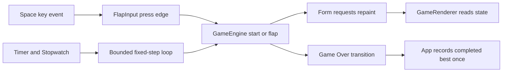

# Code walkthrough for YMH219

Use this guide to explain the delivered code with the source open. It supplements [ARCHITECTURE.md](ARCHITECTURE.md); it is not a claim that an oral review has happened.

## Responsibilities and OOP

| Type | Explanation and example |
| --- | --- |
| [Bird](../src/FlappyBird.Core/Models/Bird.cs) | Encapsulates position/velocity. Private setters force callers through Flap, Update, and Reset |
| [GameSettings](../src/FlappyBird.Core/Models/GameSettings.cs) | Immutable validated configuration; gravity and pipe spacing have one source |
| [PipePair](../src/FlappyBird.Core/Models/PipePair.cs) | Groups upper/lower geometry and one-pass scoring eligibility |
| [PipeSystem](../src/FlappyBird.Core/Services/PipeSystem.cs) | Composes two reusable pairs; moves/recycles them and requests valid gaps |
| [IGapSource](../src/FlappyBird.Core/Services/IGapSource.cs) | Substitution boundary: production randomness versus deterministic test samples |
| [GameEngine](../src/FlappyBird.Core/Services/GameEngine.cs) | Composes the domain objects and controls state, contact, points, and reset |
| [GameForm](../src/FlappyBird.App/Forms/GameForm.cs) | Adapts Windows input, focus, timer signals, accessibility, and the native restart button |
| [GameRenderer](../src/FlappyBird.App/Rendering/GameRenderer.cs) | Reads supplied state and draws it; never advances the game or accesses files |
| [HighScoreService](../src/FlappyBird.App/Services/HighScoreService.cs) | Retains completed best and brief error status; IHighScoreStore substitutes real files in tests |

Core references no App, WinForms, drawing, Windows input, or file storage. App depends on Core. This makes numeric gameplay rules independently testable. Interfaces are used where substitution is needed; the project does not require an inheritance hierarchy for every entity.

## Trace a press and an update

Ready → Running happens on a fresh Space press. Flap sets velocity to −260 units/s; holding the key cannot repeat until release. Gravity adds 600 × dt to velocity. At the default 1/60 second step, one gravity increment is 10 units/s. Explain the actual semi-implicit formula: update velocity first, then position using the updated velocity.

The UI timer schedules work; Stopwatch measures elapsed time. FixedStepLoop admits at most 100 ms and six updates per tick. Excess stall time is discarded. Focus loss stops updates and clears accumulation; return samples held Space and resumes only live runs. Painting cannot move the bird.

## Explain contact, points, and reset

GameEngine predicts motion, checks earliest swept pipe/ground contact, then either stops at contact or commits safe movement, awards eligible points, and recycles. Exact touching counts. The ceiling clamps without loss. A collision step earns no new point, but earlier points survive.

A pair scores only when its right edge is strictly left of Bird.X and HasScored is false. Marking it prevents a second point. Recycling resets that flag and gives the same object a valid new gap. Point to the tests for equality versus strict passing, contact-first ordering, and repeated cycles.

Enter or New game returns GameOver → Ready. Engine.Reset clears score, bird motion, and pipes/eligibility; the Form clears timing/input state and keeps one timer/button/handler set. The best-score service survives reset. Space held during reset must be released before starting again.

## Demonstrate a real test

Run `./scripts/dev.ps1 check`, then open [GameRulesTests](../tests/FlappyBird.Core.Tests/GameRulesTests.cs) to explain one boundary/ordering assertion. Show [FileHighScoreStoreTests](../tests/FlappyBird.App.Tests/FileHighScoreStoreTests.cs) for the locked-file case: a failed replacement preserves old data, retains the new session best, and does not crash gameplay. Explain why every test uses a temporary or memory store.

For a small code-change exercise, change a validated setting locally, predict its effect, run checks and the app, and inspect the diff. Discuss tradeoffs before committing; do not use arbitrary tuning as evidence of fair human difficulty.
